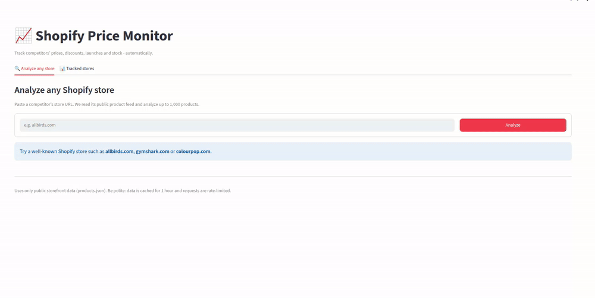

# 📈 Shopify Price Monitor

Track your competitors' Shopify stores automatically: **price changes, discounts, sitewide
sales, new launches, removed products and stock-outs**.




## Features

**Instant store analysis** 
- Catalog size, median price, share of products on sale, average discount, sold-out rate
- Price distribution and discount-depth histograms
- Category breakdown with median price, sale rate and stock-out rate
- Launch velocity (products published per month)
- Pricing psychology (.99 / .95 / .00 price endings), top vendors
- Biggest discounts and newest products, full catalog CSV export

**Continuous tracking** 
- Snapshot of every variant on each scrape
- Change events: `price_drop`, `price_increase`, `sale_started`, `sale_ended`,
  `new_product`, `product_removed`, `out_of_stock`, `back_in_stock`
- **Sitewide sale detection** when a large share of the catalog is discounted at once
- Price history per variant, activity calendar, filterable change feed

## How it works

```
 Shopify store ──► scraper.py ──► pipeline.py ──► PostgreSQL / SQLite
   (public, 250 per page)          normalize      upsert + snapshot        │
                                                  diff.py → events         │
                                                                           ▼
                         Streamlit demo ◄── analysis.py / queries.py (pandas)
```

| Module | Role |
|---|---|
| `spm/scraper.py` | Pages through `products.json` until an empty page; retries on 429/430/5xx with backoff; detects non-Shopify stores |
| `spm/diff.py` | Pure functions comparing two snapshots → change events, plus sitewide-sale detection |
| `spm/analysis.py` | Pandas metrics for a catalog |
| `spm/db.py` | SQLAlchemy 2.0 models: stores, products, variants, scrape_runs, snapshots, events |
| `spm/pipeline.py` | Fetch → upsert → snapshot → diff → save events (failed runs are recorded) |
| `spm/queries.py` | DataFrames for the app: event feed, price history, calendar |
| `spm/cli.py` | Command line interface |
| `app/streamlit_app.py` | Public demo |

## Quick start

```bash
git clone https://github.com/your-username/shopify-price-monitor.git
cd shopify-price-monitor
pip install -r requirements-dev.txt

# One-off analysis to CSV (no database needed)
python -m spm.cli export allbirds.com --max-pages 2

# Track stores (SQLite by default: data/spm.db)
python -m spm.cli add allbirds.com gymshark.com
python -m spm.cli scrape --all          # first scrape = baseline
python -m spm.cli scrape --all          # later scrapes produce events
python -m spm.cli events --days 7

# Demo
streamlit run app/streamlit_app.py
```

With PostgreSQL and a built-in scheduler (scrapes every 12 h):

```bash
docker compose up --build        # app on http://localhost:8501
```


## Configuration

All settings are environment variables (see `.env.example`):

| Variable | Default | Meaning |
|---|---|---|
| `DATABASE_URL` | `sqlite:///data/spm.db` | SQLite or PostgreSQL URL |
| `SPM_REQUEST_DELAY` | `1.0` | Seconds between pages of the same store |
| `SPM_MIN_PRICE_CHANGE_PCT` | `0` | Ignore smaller price changes |
| `SPM_SITEWIDE_SALE_THRESHOLD` | `0.25` | Share of catalog discounted in one run to flag a sitewide sale |
| `SPM_DEMO_MAX_PAGES` | `4` | Demo analyzes up to 4 × 250 products |
| `SPM_DEMO_MAX_ANALYSES` | `10` | Analyses per browser session |
| `SPM_DEMO_ALLOW_TRACKING` | `false` | Show the "Track this store" button |


## Limitations

- Some stores disable `products.json` or sit behind bot protection; they are reported as
  "not a Shopify store or feed disabled".
- Exact inventory quantities are not public; stock is tracked as available / sold out.
- Very large catalogs may cap `page`-based pagination; the scraper stops at the first empty page.

## Responsible scraping

Only public storefront data is read. Requests are rate-limited per store, identified with a
descriptive User-Agent, and demo results are cached for an hour. Don't republish competitors'
images or descriptions; show the data only to the user who tracks the store.

## Roadmap

- [x] Phase 1: scraper, database, diff engine, CLI
- [x] Phase 2: public Streamlit demo
- [ ] Email / Telegram alerts and daily digest
- [ ] Accounts, watchlists and billing (FastAPI + Next.js)
- [ ] Product matching against your own catalog (embeddings)
- [ ] AI weekly competitor briefing
- [ ] Shopify app

## License

MIT
